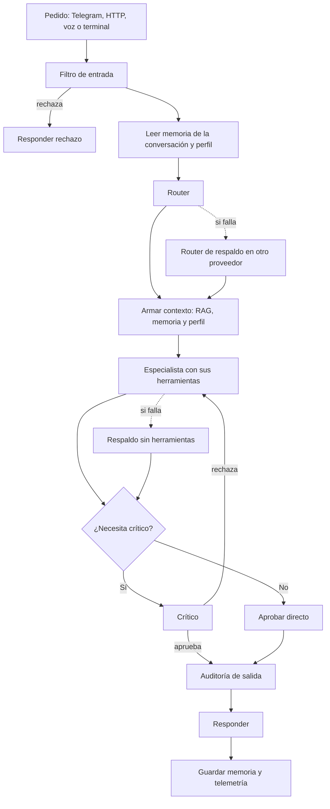

# Sistema multiagente en n8n

Un asistente personal construido como una cadena de agentes en n8n. Recibe pedidos por Telegram, HTTP, voz y una terminal de bolsillo, decide qué especialista los atiende, ejecuta acciones reales con aprobación humana y registra todo lo que hace.

Es un proyecto personal, en uso diario desde hace más de un año.

| | |
|---|---|
| Nodos del flujo central | 94 |
| Especialistas | 9 |
| Herramientas | 22 |
| Suite de regresión | 22 de 22 casos |
| Costo de operación | alrededor de US$8 por mes |

Datos medidos en agosto de 2026.

> Este repositorio es un caso de estudio. No incluye el código, los prompts, los identificadores ni las credenciales del sistema. Los prompts quedan afuera a propósito: contienen las reglas contra inyección de instrucciones, y publicarlos sería entregar el manual para evadirlas.

## Qué es

No es un chatbot con un prompt largo. Es una cadena de nodos con puntos de control: un pedido entra, pasa por un filtro de seguridad, un router decide qué especialista lo toma, se le arma un contexto, el especialista responde (con herramientas si las necesita), un crítico revisa la respuesta y el resultado sale con telemetría registrada.

La regla de diseño es usar un modelo de lenguaje solo donde aporta. El filtro de entrada, las validaciones y el registro son código común.

## Cómo funciona

Dos detalles que no se ven en el diagrama:

- **Primero se responde y después se administra.** La memoria y la telemetría se guardan después de contestar, para no sumar espera.
- **El ciclo entre el crítico y el especialista es intencional**, con un tope de reintentos.

## Los especialistas

Cada especialista tiene su propio prompt y solo las herramientas que le corresponden.

| Especialista | Para qué |
|---|---|
| Sistemas y automatización | El servidor, Docker, n8n y la telemetría |
| Arquitecto | Proyectos nuevos desde cero |
| Web y aplicaciones | Frontend, diseño y auditoría de sitios |
| Hogar e IoT | Home Assistant y los paneles de la casa |
| Finanzas | Gastos y tareas |
| Seguridad | Revisión de seguridad de diseños y flujos |
| Audio | Análisis y masterización de audio |
| Trabajo | Monitoreo y mesa de ayuda |
| General | Lo que el router no logra clasificar |

Las herramientas son subflujos de n8n, no funciones internas. Cada una se puede ejecutar y depurar por separado.

El especialista de trabajo tiene su propia base de conocimiento, separada de la personal, para que los datos laborales no se mezclen con el resto.

## Seguridad

Hay tres capas, y solo una usa un modelo de lenguaje:

1. **Filtro de entrada.** Reglas fijas sin modelo, más un presupuesto diario de pedidos y de gasto por sesión.
2. **Router.** Al clasificar, puede mandar el pedido a "rechazado".
3. **Auditoría de salida.** Revisa lo que sale, no lo que entra.

Todo lo que no es el pedido del usuario (perfil, documentos recuperados, conversación anterior) viaja envuelto en etiquetas con un valor aleatorio distinto en cada ejecución, y el texto se limpia para que un dato no pueda cerrar la etiqueta y hacerse pasar por una instrucción.

Las acciones con efecto real, como activar un flujo o encender algo en la casa, requieren aprobación humana.

## Contexto y memoria

- **El perfil se filtra por relevancia.** Antes se enviaba completo y ocupaba el 94 % del contexto de un pedido típico. Ahora se envía solo lo que aplica, y la mediana bajó de unos 20.000 caracteres a unos 6.500.
- **El RAG prioriza las guías y las fichas de proyecto** antes de cortar los resultados, para que un procedimiento definido nunca quede afuera por ranking.
- **La calidad de recuperación está medida** con una evaluación propia, no supuesta.

## El crítico

El crítico no corre siempre. Se activa cuando la respuesta propone una acción, cuando es larga o cuando ya hubo un reintento.

Saltearlo casi no ahorra dinero, porque el crítico usa cerca del 8 % de los tokens. Lo que baja es la espera: la latencia mediana pasó de 16,6 a 8,6 segundos.

El crítico evalúa dos cosas por separado. Un puntaje mide la forma. Otro mide si la respuesta resuelve el pedido, y si no lo resuelve no dispara un reintento, sino que pide revisión humana y bloquea el guardado en memoria. Reintentar no corrige un error de fondo.

## Lo que aprendí operándolo

**Este sistema no falla con errores. Falla en verde.** Todos los apagones grandes fueron silenciosos: la ejecución figuraba como exitosa y la respuesta salía degradada sin que nada lo avisara.

| Incidente | Qué pasó | Qué cambió |
|---|---|---|
| RAG sin funcionar al menos 6 días | Se agotó la cuota de un servicio y el error se convertía en "no encontré nada" | Un error dejó de tratarse como resultado vacío, y se sumó un control diario |
| Apagón total | El proveedor principal sin crédito y el modelo de respaldo dado de baja, las dos cosas a la vez | El respaldo nuevo se eligió midiendo con el prompt real del router |
| Respaldo caído por segunda vez | El control probaba una clave guardada en un archivo, no la credencial que usa el sistema | El control ahora ejercita la credencial real |
| Auditor que dejó de correr | El propio vigilante falló sin avisar | Manejo de errores y limpieza garantizada en el script |

De ahí salieron tres reglas de trabajo:

1. Verificar el estado real del sistema antes de proponer un cambio, nunca desde una nota vieja.
2. Consultarle al agente, pero no creerle sin validar.
3. Un camino que nunca se ejecutó no está probado, aunque el código se vea bien.

## Números de 30 días

Medidos en agosto de 2026:

| | |
|---|---|
| Ejecuciones totales | 812 |
| Ejecuciones de uso real | 111 |
| Costo | US$8,34 |
| Latencia mediana | 13,3 s |
| Latencia percentil 90 | 28,9 s |

El resto de las ejecuciones son sondas de control y flujos satélite. Con unos 4 pedidos reales por día, el volumen es la principal limitación del proyecto: cualquier métrica basada en tasas es ruido, y cualquier mejora que necesite juntar ejemplos tarda meses.

## Tecnologías

n8n · Gemini · Groq como proveedor de respaldo · Pinecone · Telegram · Home Assistant · Docker · Raspberry Pi · túnel de Cloudflare

## Autor

David Seifert · Analista Senior de Infraestructura IT y Automatización · [LinkedIn](https://www.linkedin.com/in/david6seifert)
